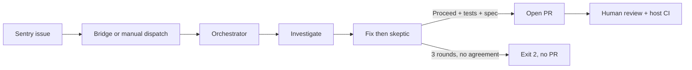

# Orchestrator — quick look

Mind map for the Sentry → Cursor → GitHub PR loop. Detailed internals: [runtime](../orchestrator/runtime.md).

## In short

This package turns a Sentry issue into a **human-reviewed** GitHub PR. It runs in GitHub Actions (or locally): parse the payload, skip duplicates, then run Cursor cloud agents (investigate → fix/skeptic up to three times → open PR). It never auto-merges.

## How it works

1. A Sentry alert reaches GitHub as `repository_dispatch` (via the Ruby bridge) or someone runs the CLI / `workflow_dispatch`.
2. The orchestrator parses the payload, checks the kill switch, and skips if the same fingerprint already has a lock or open PR.
3. An investigator agent maps the stack to code. It does not edit.
4. A fixer agent patches a dedicated branch and must show a regression spec plus passing tests. A skeptic agent reviews; that review is **prompt-only**, not a sandbox.
5. On agreement, a PR-author agent opens a PR for humans. After three unsuccessful rounds, the process stops with no PR.

## Features

### Fingerprint dedupe

Repeat Sentry events for the same bug (normalized title + culprit + top app frame) share one lock. While the lock or an open PR exists, later fires exit 0 as skipped.

### Fix/skeptic loop

Hard cap of three Block/Revise cycles. Agreement needs skeptic **Proceed** with no Critical/High findings, fixer **Tests passed: YES**, and a regression spec path. Host CI must still re-run that spec.

### Kill switch

Agents stay off unless `SENTRY_AUTO_FIX_ENABLED` is an explicit on-value. Unset means disabled.

## Key facts at a glance

| Fact | Value |
|------|--------|
| Max fixer↔skeptic rounds | 3 (hard cap) |
| Default model | `composer-2.5` |
| Node | 22.13+ |
| Auto-merge | Never |
| npm name | `@gohub/sentry-loop-orchestrator` (Git install until published) |

## Safety at a glance

- Sentry title/stack/URL are wrapped as untrusted data (delimiters + instruction-phrase neutralization). Pattern matching is not the only control.
- Cloud Cursor agents **cannot** be tool-allowlisted today; the skeptic cannot be made read-only in code. Human review + host CI are the write gate.
- Kill switch default off; GitHub owner/repo required and name-validated; no auto-merge.
- Scope budget in-package: max 3 rounds. No wall-clock/token cap yet — cap Actions concurrency on the host workflow.
- Audit: console summary + optional `RESULT_PATH` JSON (summary by default; full transcripts only if `RESULT_FULL=1`).

## Why this approach

- Sentry cannot call GitHub `repository_dispatch` with a Bearer token, so a bridge (or a human) must fire the workflow.
- Prompt-only skeptic plus agreement parsers are weaker than a sandbox, but they fail closed on missing proof and never merge.
- Dedupe locks are GitHub issues (no extra store) so concurrent Actions runs converge on one winner.

## Tradeoffs

- Good for unattended prod alerts that still need a human merge.
- Cloud agents have a full toolset; a poisoned Sentry field can still steer a run. Do not skip host CI.
- Poor fit if you need a hard read-only reviewer or a published SaaS with a landing page — this is a library/CLI.

## Go deeper

- [Runtime internals](../orchestrator/runtime.md) — entrypoints, call flow, files, guardrail map
- [SECURITY.md](../../SECURITY.md) — operator threat model
- [CONTRACT.md](../../CONTRACT.md) — `client_payload` wire shape
- [ARCHITECTURE.md](../../ARCHITECTURE.md) — short sequence
- Bridge: [sentryloop_rubybridge](https://github.com/mcrisologo/sentryloop_rubybridge)
